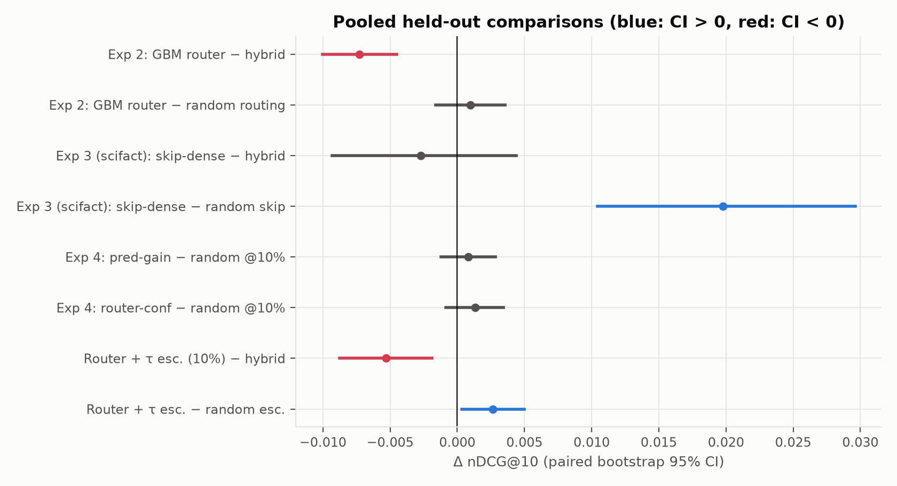

# Confidence-Based Query Routing for Hybrid Retrieval: Final Report

## Abstract

We tested whether a cheap per-query router can choose between BM25, dense and hybrid retrieval, and send uncertain queries to a cross-encoder, better than a single tuned hybrid. On held-out queries it cannot: the pre-registered router is 0.0073 nDCG@10 below always-hybrid, and the full system with budgeted escalation is 0.0053 below. Pre-registered follow-up tests on 16 further datasets show why. No group of queries identifiable before retrieval prefers one retriever, and which retriever wins depends mostly on the relevant document, not the query. A per-document fusion model gives a small gain over hybrid (+0.0029 [+0.0019, +0.0038]). Skipping dense retrieval for about a third of queries costs little quality, but saves time only on some corpora.

## 1. Problem

Search systems usually combine two retrievers: BM25, which matches exact words, and a dense (embedding) retriever, which matches meaning. A hybrid mixes their scores with one fixed weight α. A cross-encoder can then re-rank the top results, but it is slow.

We asked whether a cheap, per-query decision could do better than one fixed hybrid:

1. Pick BM25, dense or hybrid for each query, using features computed from the query and the first results.
2. Send only the uncertain queries to the cross-encoder, within a small budget.

We expected better ranking at similar cost. Held-out results do not support this: always-hybrid is the best cheap policy. Phase 2 explains why, and finds a small gain from a different approach.

**Prior work and what is new.** Arabzadeh, Yan and Clarke (CIKM 2021) already predict per query whether to use sparse, dense or hybrid retrieval, so per-query routing itself is not new. Here we add held-out evaluation against a tuned hybrid with matched random controls, budgeted cross-encoder escalation, and a split-half test of why routing fails. Learning-to-rank fusion (our E6 model) is a known technique. Our contribution there is the evidence that it beats routing.

## 2. Setup

- **Retrievers:** BM25 (k1 = 1.2, b = 0.75), dense `intfloat/e5-small-v2`, hybrid with α tuned on training folds, plus RRF as a baseline. Top-100 lists.
- **Features:** 18 per query (6 about the query text, 12 about the retrieval results: score gaps, list overlap, rank correlation and so on).
- **Metric:** nDCG@10.
- **Evaluation:** 5-fold cross-validation by query (seed 42), paired bootstrap with 10,000 resamples, practical margin δ = 0.005. Every result below is on held-out queries.
- **Phase 1 data:** NFCorpus, SciFact, FiQA, CQADupStack-Unix and a Quora subset (3,343 queries).
- **Phase 2 data:** two kinds. *Exploration* data (19 datasets, already seen) was used to form the hypotheses and, for 16 of them, to train the E6 fusion model. *Held-out* data (16 datasets: validation, fresh, boundary and Climate-FEVER sets) was used once each for the pre-registered tests. They cover forums, science, open-domain QA, multi-hop QA, entity search and fact-checking. A second encoder (e5-base) was used for robustness.

## 3. Phase 1: Does routing work?

| | Hypothesis | Result |
| :-- | :-- | :-- |
| H1 | Routing beats hybrid and RRF | **Not supported.** Pre-registered GBM router −0.0073 [−0.0100, −0.0045] vs hybrid. The cost-aware router (Exp. 2d) beats RRF (+0.0142 [+0.0100, +0.0183]), but so does plain hybrid (+0.0153). |
| H2 | Recall@100 stays level with hybrid | **Supported.** The GBM, cost-aware and router + τ policies are all within ±0.01. The logistic router is not (−0.0224). |
| H3 | Budgeted escalation keeps most of the rerank gain | **Not supported.** The plain reranker is worse than hybrid. With a blended score, a 10% budget keeps 16% of the gain. |
| H4 | Latency stays near hybrid | **Partly.** The router adds 5–13 ms. A 10% escalation costs 1.2–7× hybrid. Always-rerank costs 348–406 ms per query (45 ms on Quora, whose documents are short). |

### Analysis

- **Headroom is small and mostly noise.** A per-query oracle beats hybrid by +0.034, but an "oracle" over three near-identical hybrids already gets +0.015. The real headroom is about +0.02, and no held-out router reaches it.
- **Class balancing caused much of the loss.** A cost-aware router (no balancing, fall back to hybrid unless inner CV shows a gain) reaches −0.0012 [−0.0025, +0.0002]. That is not worse than hybrid, but not better either.
- **A dual advantage-regression router** (predict how much BM25 and dense each gain over hybrid, route only when the prediction clears a risk threshold) sends 99% of queries to hybrid and gains nothing: −0.0001 [−0.0007, +0.0003]. It falls back to hybrid unless its out-of-fold gain is significant (z ≥ 1.645). A version with fixed thresholds and no guard is also not different from hybrid (−0.0009 [−0.0028, +0.0009]). Dropping feature groups does not change this: every subset stays within ±0.0003 of hybrid, while the classifier is significantly below hybrid for every subset.
- **Rerankers.** MiniLM-L6, MiniLM-L12 and BGE-base all lower average nDCG@10 on these pools. Blending the cross-encoder score with the hybrid score does beat hybrid (+0.0067 [+0.0035, +0.0098] when applied to every query). Reranking only each query's top-20 keeps the full gain at about 40% of the cost (post hoc).
- **Router + τ escalation, the proposal's full system.** It routes, then escalates a query to the cross-encoder when the router's top probability falls below τ. At a 10% target (9.5% realized) it scores −0.0053 [−0.0088, −0.0019] vs hybrid and +0.0026 [+0.0003, +0.0050] vs random escalation. Router confidence does pick out the router's own mistakes (risk-coverage is better than random on all five datasets), but it does not predict where reranking helps.
- **Skipping dense retrieval is the one pre-registered success (Exp. 3).** The router skips dense for 32.9% of queries at −0.0053 vs hybrid, and beats random skipping by +0.0104. A free rule using the BM25 top-1/top-2 score ratio does as well. The wall-clock saving is real only where many queries are skipped (Quora −40% latency, FiQA +20%).

*Figure 1. Pooled paired differences in nDCG@10 with 95% bootstrap CIs. Routing, with or without τ escalation, is below always-hybrid. Dense skipping and router + τ escalation beat their random controls.*

## 4. Phase 2: Why does routing fail?

Phase 1 failed, so we wrote down explanatory hypotheses. Each was pre-registered (written and hashed before its data was downloaded) and run once on new datasets chosen by fixed rules.

| | Hypothesis | Verdict |
| :-- | :-- | :-- |
| E1 | A router trained on synthetic queries fails on real ones, because the synthetic winners are obvious by construction | **Accepted.** −0.0209 [−0.0256, −0.0162] vs hybrid. On synthetic queries, query length alone predicts the winner perfectly. On real ones the best feature scores AUC′ 0.60. |
| E2 | No group of real queries, identifiable before retrieval, does better with one retriever | **Accepted in four separate tests.** BM25 and dense are below hybrid in every group. The router stays within ±0.002 of hybrid. Best feature AUC′ is 0.57–0.60. |
| E3 / E3′ | A skip router can avoid dense retrieval for at least 20% of queries | Not met / inconclusive. Both as predicted (12–13% skipped on forums). |
| E4 | The winning retriever is a property of the document, not the query | **Inconclusive.** The pooled AUC′ was 0.7498, just under the 0.75 reject threshold, and HotpotQA drives it. Without HotpotQA it is 0.522. |
| E4-R | E4 redone on one dataset with alternative relevant documents (Climate-FEVER) | **Accepted.** AUC′ 0.507, which is chance. |
| E5 | A small, frozen niche of queries exists where routing wins | **Rejected**, as predicted. |
| E6 | Fusing per document beats fixed-α hybrid | **Accepted.** +0.0029 [+0.0019, +0.0038] pooled. |
| E7 | The free BM25-ratio rule matches the learned skip router | Inconclusive (works on 5 of 6 datasets, not HotpotQA). |
| E8 | Multi-hop data is the exception | Inconclusive. 2WikiMultihopQA behaves like HotpotQA. MuSiQue does not. |

**The main finding is E4/E4-R.** To test whether the winner is a property of the query, we split each query's relevant documents in half and checked whether the same retriever wins both halves. It mostly does not (AUC′ near 0.5). So there is little for a query-level router to learn. Multi-hop datasets, where all relevant documents are needed together, are the exception.

**What works instead (E6).** A LightGBM LambdaRank model scores each candidate document using normalised BM25 and dense scores, ranks and the query features. It was trained once on 16 exploration datasets and applied unchanged to six fresh ones. Pooled gain over hybrid is +0.0029, positive on all six datasets and significant on two (NQ, HotpotQA). It costs about 5 ms more per query. Against an α tuned on each target's own labels, the gain is +0.0011 [+0.0000, +0.0021], and NQ is significantly worse. The effect is small.

**Checks that the null result is real.** The router's hybrid fallback is a symptom, not the cause: removing it makes the router worse (−0.0023). Re-averaging so every query group counts equally (macro nDCG) leaves the router within ±0.0011 of hybrid, and BM25 or dense alone stay 0.03–0.09 below it.

**Predictions.** 9 of 13 pre-registered predictions were correct. All four misses involve multi-hop data.

## 5. Conclusions

1. Always-hybrid is the strongest dependable cheap policy. No router or selective-escalation policy beats it on natural queries.
2. Routing fails because the right retriever is largely decided per document, not per query, and pre-retrieval features cannot see that.
3. Synthetic query sets make routing look like it works. That is an artefact of how they are built.
4. Skipping dense retrieval is feasible for about a third of queries at a small quality cost, and a free score-ratio rule does as well as a learned model. It saves time only when the corpus or encoder is expensive enough.
5. Per-document fusion gives a small gain (+0.003) for a small cost. Blended reranking also beats hybrid (+0.0067) but at 40% or more of full-rerank cost, so per-document fusion is the only cheap gain.

## 6. Limitations

- All effects are small, and per-dataset sample sizes are modest.
- One encoder family (e5), one fusion form (min-max convex), one candidate depth.
- Large corpora were capped at 50,000 documents, which makes retrieval easier than on the full collections.
- Latency was measured on one laptop, one pass per query.
- The split-half test only covers queries with at least two relevant documents. Climate-FEVER's judgments may be noisy, which alone would push its AUC′ towards 0.5.
- The E5 encoder was trained on data that includes NQ, so NQ is not new to it.
- E4's pooled design was a mistake, corrected afterwards in E4-R. Both are reported.
- **Pre-registration caveat.** The pre-registration files were committed to git together with the results, so git history alone cannot prove they came first. Only file hashes and file timestamps support the ordering, and neither is tamper-proof. One pre-registration file also states it was committed before download, which git does not show; it is hash-locked and cannot be edited.
- A team member ran an exploratory per-source α check on DBpedia-Entity on 2026-11-05, before its pre-registration, so DBpedia was not fully unseen.
- The 30k synthetic-query scaling run was not done. It needs raw data, a GPU and the dense libraries. The generator and tests exist, but there is no scaling curve.
- Two post hoc analyses (cost per 1k queries, category-balanced nDCG) are labelled as such in the main reports.

<!-- ## 7. Where to find things

| What | Where |
| :-- | :-- |
| Phase 1 full report | `report/report.md` |
| Phase 2 full report | `report/phase2_report.md` |
| Pre-registrations and hashes | `results/preregistration/` |
| Phase 1 tables and figures | `results/metrics/`, `report/figures/` |
| Phase 2 results | `results/strengthening/`, `results/phase2_validation/` |
| Routers, features, synthetic queries | `src/router_retrieval/` |
| Experiment scripts | `scripts/` | -->
