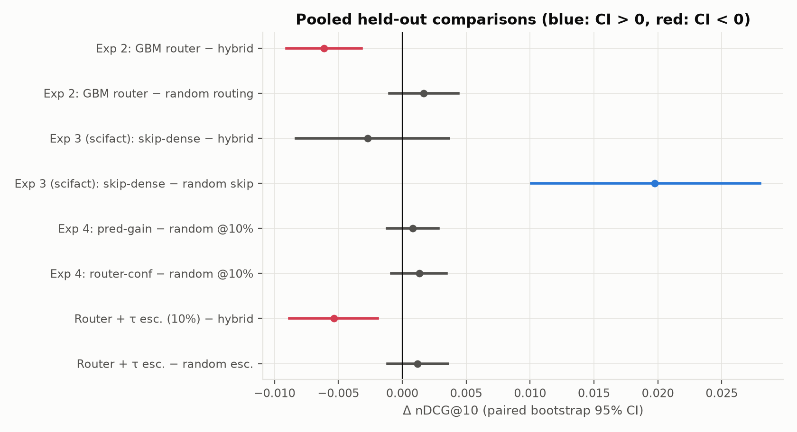
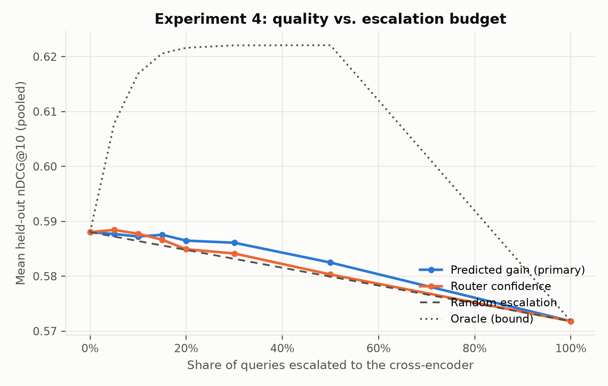
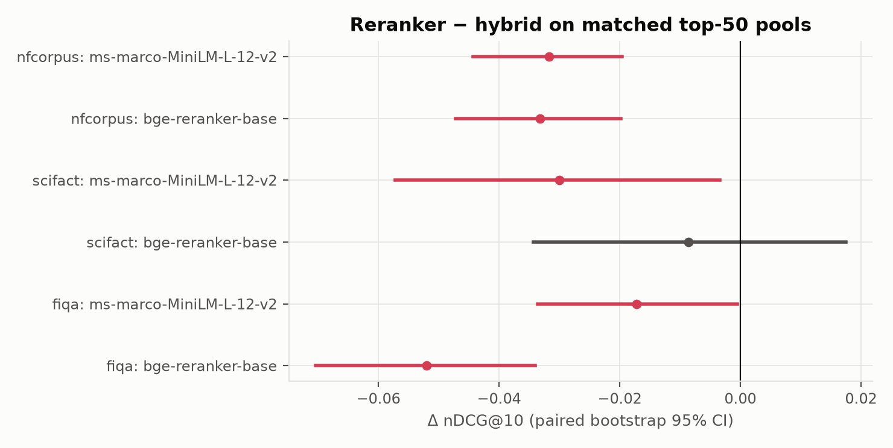
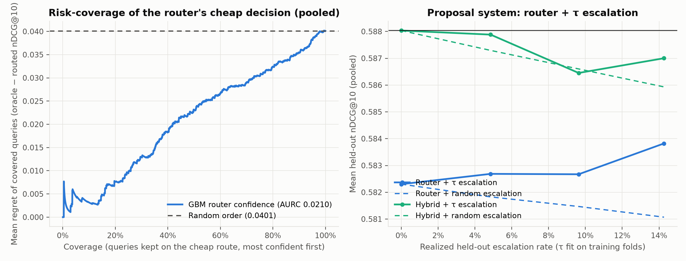
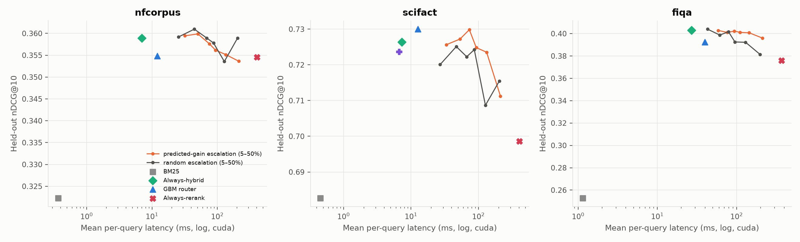

# Confidence-Based Query Routing for Hybrid Retrieval

## Abstract

We evaluate query-adaptive retrieval and budgeted cross-encoder escalation on five BEIR-style query sets using held-out five-fold predictions over 3,343 queries. The pre-registered LightGBM route classifier scores 0.0061 nDCG@10 below always-hybrid (95% paired bootstrap CI [−0.0091, −0.0032]) and does not beat a matched random router. The proposal's full system, which routes and then escalates to a cross-encoder when the router's maximum probability falls below a threshold τ calibrated on training folds, is also below always-hybrid (−0.0054 [−0.0089, −0.0019] at a 10% target, 9.6% realized). Router confidence does rank its own routing mistakes better than chance, but it does not predict which queries the reranker improves. The preregistered MiniLM-L6 reranker lowers mean nDCG@10. Predicted-gain escalation at 10% does not significantly beat random escalation. Two stronger checkpoints (MiniLM-L-12, BGE-reranker-base) also show no positive average gain over hybrid on three datasets. Measured on an RTX 2050, reranking the top-50 costs 340–400 ms per query against 7–27 ms for always-hybrid, so a 10% escalation budget multiplies mean latency by 2.5–7×. The saved Experiment 3 run (SciFact, 300 queries) supports selective dense skipping on quality, but at these corpus sizes it saves only about 9% of wall-clock latency. Always-hybrid remains the strongest dependable cheap policy.

## 1. Introduction and Research Questions

Search systems commonly combine lexical matching with semantic retrieval. BM25 is effective for exact terms and identifiers; dense retrievers can find semantically related passages; hybrid retrieval combines both candidate lists. Cross-encoders can score query-document pairs jointly, but add inference cost. This project began with the hypothesis that inexpensive query and retrieval features could choose among BM25, dense, and hybrid, then escalate uncertain queries to a cross-encoder.

The initial proposal expected routing to outperform a fixed hybrid and selective reranking to retain most of the always-rerank gain at a low budget. The experiments below test those claims against held-out queries and matched random controls. We report negative results directly. In particular, a per-query oracle is an upper bound and does not demonstrate that a learnable signal can identify the winning route.

### 1.1 Hypotheses and operational outcomes

| Hypothesis | Test | Outcome |
| :--- | :--- | :--- |
| H1: Query-adaptive routing improves ranking quality over fixed-α hybrid and RRF. | Held-out route policy, with and without τ escalation, versus always-hybrid and matched random routing; RRF from the same runs. | Not supported against hybrid; supported against RRF. Pre-registered GBM routing: −0.0061 [−0.0091, −0.0032]; router + τ escalation (10%): −0.0054 [−0.0089, −0.0019]. The loss is mostly from class balancing: the cost-aware router (Experiment 2d, exploratory) is −0.0012 [−0.0025, +0.0002] nDCG@10, −0.0007 [−0.0024, +0.0010] MRR@10, −0.0007 [−0.0022, +0.0008] MAP, so it is non-inferior but not better. Adding cross-encoder relevance features for each route's top-3 (Experiment 2e) gives −0.0003 [−0.0017, +0.0011]. Against RRF it is +0.0142 [+0.0100, +0.0183] nDCG@10 pooled (also better on MRR@10 and MAP), significant on four of five datasets; on SciFact it is −0.0061 [−0.0211, +0.0094], inconclusive. That gain comes from convex fusion with a tuned α, not from routing: always-hybrid beats RRF by about as much. |
| H2: Recall@100 matches or slightly improves on fixed hybrid. | Held-out Recall@100 of the routed list vs always-hybrid; equivalence margin ±0.01, fixed before computing (`results/h2_router_recall/`). Reranking alone cannot change Recall@100. | Supported (equivalence, no improvement). Pooled router − hybrid: GBM −0.0055 [−0.0093, −0.0017], cost-aware −0.0003 [−0.0018, +0.0010], router + τ at 10% −0.0032 [−0.0067, +0.0001], all inside ±0.01. The logistic router fails (−0.0219). FiQA is the weak spot for the Experiment 2 router (−0.0198 [−0.0310, −0.0096]). |
| H3: Budgeted escalation retains most of the always-rerank quality gain at a small fraction of its cost. | Predicted-gain, rank-by-confidence and τ-threshold escalation versus random escalation at the same rate. | Not supported. With pure MiniLM-L6 reranking (and two stronger checkpoints) the backend has no positive gain over hybrid, so there is nothing to retain. Experiment 4b (exploratory) fixes that with a blended backend λ·CE + (1 − λ)·hybrid, which beats hybrid by +0.0067 [+0.0035, +0.0098] when always on. At a 10% budget, predicted-gain escalation retains only 16% of that gain (+0.0011 [−0.0001, +0.0023] vs hybrid; +0.0004 [−0.0007, +0.0016] vs random). Router confidence retains 29%. "Most" of the gain is reached only at about 50% escalation, which is not a small fraction of the cost. Spending the same cross-encoder budget on every query instead (Experiment 4c, exploratory) also fails the pre-declared test: blended reranking of every query's top-5 (5 pairs, the cost of escalating 10% over 50 documents) gives +0.0010 [−0.0013, +0.0033], 15% retained. A deeper rerank does better (secondary): top-20 for every query recovers the full always-blended gain, +0.0067 [+0.0039, +0.0095], at 40% of the cross-encoder pairs and roughly 40% of always-rerank's latency. |
| H4: Mean per-query latency stays near hybrid and far below always-rerank. | Measured per-query component latency, composed per policy from the same held-out decisions (§3.5). | Partly. Router-only adds about 5–13 ms to hybrid's 7–27 ms. Any escalation at 10% raises mean latency to 44–76 ms (2.5–7× hybrid), still well below always-rerank (368–406 ms). The p95 of every escalation policy is close to always-rerank's. The cost-aware router uses the same features and model, so its cost is the same. |

Oracle headroom and the original hybrid-degradation framing are descriptive analyses, consistent with the issue log, not confirmatory evidence.

### 1.2 Position relative to prior work

Adaptive-RAG routes questions among retrieval-augmented generation strategies by estimated question complexity; this project instead evaluates selection among lexical, dense, and hybrid retrieval, then tests selective reranking. Arabzadeh, Yan and Clarke (CIKM 2021) already predict per query whether to use sparse, dense, or hybrid retrieval from query-only features, so per-query routing among these routes is not new; this project's distinct pieces are held-out evaluation against a tuned hybrid, confidence-based escalation under a budget, and risk-coverage analysis. DAT uses an LLM to tune the lexical/dense mixture per query, while this project tests learned and hand-crafted signals. Reciprocal Rank Fusion is a score-scale-independent rank-combination baseline, computed here for NFCorpus, SciFact, and FiQA. These distinctions motivate the study; this evaluation does not reproduce those papers' benchmarks.

## 2. Method and Evaluation Protocol

### 2.1 Systems and features

The first-stage systems are BM25, a dense bi-encoder, and a convex hybrid over min-max-normalized BM25 and dense scores. The hybrid dense weight α is selected from a grid on training queries only. The BM25 normalization uses a zero floor when a truncated BM25 list implies that missing documents have score zero. This prevents a single BM25 hit from being normalized to the same score as an unretrieved document.

The original classifier uses 18 query and retrieval-signal features: query length, IDF and rare-term statistics, entity and out-of-vocabulary density, top-k list overlap, rank correlation, top scores, score gaps and entropy, top-score ratio, and query-term coverage. GBM labels use a margin rule that defaults near-ties to hybrid; training weights scale with the spread of route scores. The separate Experiment 3 skip model uses only query and BM25 signals available before dense retrieval.

Escalation reranks the hybrid top-50 with `cross-encoder/ms-marco-MiniLM-L-6-v2` (ranks 51–100 kept in order). Three selection rules are evaluated: predicted gain (a LightGBM regressor of reranked − hybrid nDCG@10), lowest router confidence at a fixed budget (Experiment 4), and the proposal's threshold rule, which escalates when max P(route) < τ (§3.4).

### 2.2 Datasets and metrics

The evaluation covers NFCorpus (323 test queries), SciFact (300), FiQA (648), CQADupStack Unix (1,072), and a deterministic Quora subset (1,000). The Quora subset retains the sampled queries' relevant documents and 50,000 random distractors. Experiments 2–4 use `intfloat/e5-small-v2` for dense retrieval and top-100 candidate lists; Experiment 1 used `msmarco-distilbert-base-v4`, so its absolute values are not directly comparable with later experiments.

The primary measure is nDCG@10. MRR@10, MAP, and Recall@100 are reported for baseline systems. Held-out results use five-fold cross-validation within each dataset with seed 42 and a paired bootstrap with 10,000 resamples; paired Wilcoxon tests and win/loss/tie counts are in `results/metrics/combined.md`. Parameters and thresholds are selected from training folds. Pooled statistics combine per-query held-out predictions across the five datasets.

### 2.3 Registered and exploratory comparisons

Pre-registered (improvements.md §3–4, hash in `results/preregistration/`): Experiment 2 compares GBM routing with always-hybrid and a random policy using the router's own route proportions. Experiment 3 asks whether BM25 can replace hybrid for selected queries while preserving quality and reducing dense calls. Experiment 4 compares predicted-gain and low-confidence escalation with random escalation at the same budget.

Exploratory (labelled as such below): the matched-pool reranker benchmark, router + τ escalation with risk-coverage analysis, noise-corrected oracle headroom, and measured per-policy latency. Oracle results are reported only as upper bounds.

### 2.4 Advantage regression and cost-aware routing

A three-class classifier trained on 0/1 labels treats every wrong route as equally bad, but the cost of a wrong route is asymmetric: leaving hybrid for BM25 loses 0.31 nDCG@10 on average when it is wrong and gains 0.20 when it is right, and it is wrong four times as often (28% vs 7% of queries). Two routers address this directly.

*Dual advantage regression* (Experiment 2b, `plan.md` Track 2) fits two LightGBM regressors to the per-query advantages Δ_BM25(q) = nDCG@10(BM25, q) − nDCG@10(hybrid, q) and Δ_dense(q), and routes away from hybrid only when a predicted advantage exceeds a risk threshold θ. The pair (θ_BM25, θ_dense) is chosen on out-of-fold predictions within the training fold, and the router reverts to always-hybrid unless that out-of-fold gain is positive with z ≥ 1.645.

The *cost-aware classifier* (Experiment 2d, exploratory, pre-declared in `results/preregistration/experiment2d_cost_aware_router_20261031.md`) keeps the Experiment 2 GBM but removes class balancing, labels a query BM25 or dense only if that route beats hybrid by ≥ ε (the original rule compared the top route with the runner-up), and treats always-hybrid as one more candidate in the inner-CV choice of ε. Its variants train on a blended target 0.6·nDCG@10 + 0.4·MRR@10 (`improvements.md` §2.3) or add the PCA-32 query embedding of Experiment 2c.

## 3. Results

*Figure 1. Pooled paired differences in nDCG@10 with 95% bootstrap CIs. Only dense skipping (SciFact) beats its random control; routing, with or without τ escalation, is below always-hybrid.*

### 3.1 Initial hybrid analysis and held-out route selection

Across NFCorpus, SciFact, and FiQA, the tuned hybrid was the best fixed system in mean nDCG@10. The original H1 “degraded query” prevalence compares hybrid with the per-query maximum of BM25 and dense; this selected maximum is biased upward by construction. The project issue log therefore withdraws the original H1 verdict and treats per-query oracle headroom as a bound. A separate, predefined query-type analysis on Unix technical/plain queries and Quora conversational queries found hybrid ahead of both single retrievers in each group; each group's best α was 0.6.

The decisive held-out comparison pooled 3,343 queries. GBM routing achieved 0.5819 nDCG@10 versus 0.5880 for always-hybrid, a difference of −0.0061 (95% CI [−0.0091, −0.0032]). Logistic routing scored 0.5632. GBM routing differed from random routing at the same route proportions by +0.0017 (95% CI [−0.0010, +0.0044]), which is inconclusive. The router sends 68–95% of queries to hybrid.

Fresh baseline evaluation was possible for NFCorpus, SciFact, and FiQA, the raw test collections with complete local files. The table reports nDCG@10 / MRR@10 / MAP / Recall@100. Tuned hybrid outperforms RRF on NFCorpus and FiQA; on SciFact RRF's small nDCG advantage is inconclusive (paired bootstrap Δ = +0.0054, 95% CI [−0.0065, +0.0174]).

| Dataset | BM25 | Dense | Tuned hybrid | RRF |
| :--- | :--- | :--- | :--- | :--- |
| NFCorpus (n=323) | 0.3223 / 0.5270 / 0.1442 / 0.2463 | 0.3255 / 0.5237 / 0.1478 / 0.2971 | **0.3589 / 0.5757 / 0.1690 / 0.3090** | 0.3509 / 0.5631 / 0.1644 / 0.3067 |
| SciFact (n=300) | 0.6827 / 0.6455 / 0.6403 / 0.9276 | 0.6875 / 0.6580 / 0.6505 / 0.9277 | 0.7264 / 0.6951 / 0.6887 / 0.9583 | **0.7318 / 0.7025 / 0.6924 / 0.9617** |
| FiQA (n=648) | 0.2528 / 0.3132 / 0.2055 / 0.5523 | 0.3747 / 0.4426 / 0.3152 / 0.6807 | **0.4029 / 0.4826 / 0.3430 / 0.6995** | 0.3741 / 0.4450 / 0.3129 / 0.6949 |

### 3.2 How much headroom does routing have?

The routing oracle (best of BM25, dense, hybrid per query) is +0.0344 above hybrid pooled, but a per-query maximum also profits from rank jitter. An “oracle” over three near-identical hybrids (α* − 0.1, α*, α* + 0.1) already gains +0.0148. Subtracting that noise floor leaves +0.0195 [+0.0167, +0.0224] pooled: just under the proposal's 2-point week-2 gate, and only SciFact, FiQA, and Unix clear it individually (`results/metrics/oracle_headroom.md`).

| Dataset | Hybrid | Oracle − hybrid | Noise oracle − hybrid | Noise-corrected headroom |
| :--- | ---: | :--- | :--- | :--- |
| NFCorpus | 0.3589 | +0.0288 [+0.0228, +0.0352] | +0.0114 | +0.0174 [+0.0124, +0.0226] |
| SciFact | 0.7264 | +0.0647 [+0.0476, +0.0835] | +0.0215 | +0.0432 [+0.0287, +0.0588] |
| FiQA | 0.4029 | +0.0436 [+0.0364, +0.0512] | +0.0236 | +0.0200 [+0.0136, +0.0266] |
| CQADupStack Unix | 0.3764 | +0.0418 [+0.0354, +0.0486] | +0.0188 | +0.0230 [+0.0176, +0.0286] |
| Quora (subset) | 0.9674 | +0.0131 [+0.0092, +0.0174] | +0.0040 | +0.0091 [+0.0060, +0.0125] |
| **Pooled** | 0.5880 | +0.0344 [+0.0311, +0.0378] | +0.0148 | +0.0195 [+0.0167, +0.0224] |

Even this corrected headroom is an upper bound: the held-out router realizes none of it. Margin labels at each fold's α* and ε put 82–95% of queries in the hybrid class (`results/labels/label_summary.md`).

### 3.3 Skipping dense retrieval

The currently saved Experiment 3 result covers SciFact (300 held-out queries): the skip router omitted dense retrieval for 46.7% of queries and scored 0.7237 nDCG@10 versus 0.7264 for always-hybrid, a difference of −0.0027 (95% CI [−0.0083, +0.0037]). It meets the three registered criteria on this dataset: the confidence interval lower bound exceeds −0.01, savings exceed 20%, and the router beats expected random skipping by +0.0198 (95% CI [+0.0101, +0.0280]). The project issue log records a broader pooled result (32.9% skipped; approximately −0.005 nDCG@10), but current per-query/table artifacts contain only SciFact, so that result is not independently reproducible from this checkout.

The BM25 top-1/top-2 ratio heuristic is close to the learned classifier in the saved SciFact cost-quality curve. Measured latency (§3.5) shows the practical saving is small at this corpus size: skipping 46.7% of dense calls lowers mean latency from 7.33 ms to 6.67 ms (−9%), because the skip features and router cost about 2.6 ms per query against roughly 6.9 ms of dense encoding, search and fusion.

### 3.4 Cross-encoder escalation

**Experiment 4 (pre-registered).** The MiniLM-L6 reranker lowered pooled nDCG@10 from 0.5880 for always-hybrid to 0.5718 for always-rerank. At a 10% budget, predicted-gain escalation scored 0.5872 and random escalation 0.5864. Their difference was +0.0008 (95% CI [−0.0012, +0.0028]); router-confidence escalation also did not significantly beat random (+0.0013 [−0.0009, +0.0035]). The oracle-selected 10% reached 0.6169, so beneficial reranks exist, but the tested features did not identify them (Spearman of predicted and true gain −0.05 to +0.07). Since always-rerank is worse than hybrid on average, “quality retained” has no meaningful denominator and is reported as not applicable.

*Figure 2. Experiment 4: pooled held-out nDCG@10 against the share of queries escalated, for each selection policy.*

**Stronger checkpoints (exploratory).** The result motivated a matched-pool evaluation of two stronger checkpoints on the three datasets with complete local retrieval runs, using the same fold-selected hybrid top-50 pools (CUDA, batch size 8). Neither checkpoint improved nDCG@10 on any dataset. All six paired estimates are non-positive; five confidence intervals exclude zero in the negative direction, and BGE on SciFact is inconclusive. Recall@100 is unchanged in every case. Since neither alternative has positive mean gain over hybrid, no selective-escalation replay was run with them. The preregistered MiniLM-L6 result remains the primary Experiment 4 result.

| Dataset | Checkpoint | Hybrid nDCG@10 | Reranked nDCG@10 | Δ [95% paired bootstrap CI] | Recall@100 | Mean / p95 reranker ms |
| :--- | :--- | ---: | ---: | :--- | ---: | ---: |
| NFCorpus (n=323) | MiniLM-L-12 | 0.3589 | 0.3272 | −0.0317 [−0.0443, −0.0196] | 0.3090 (unchanged) | 621 / 709 |
| NFCorpus (n=323) | BGE reranker-base | 0.3589 | 0.3257 | −0.0332 [−0.0473, −0.0198] | 0.3090 (unchanged) | 3,146 / 3,544 |
| SciFact (n=300) | MiniLM-L-12 | 0.7264 | 0.6964 | −0.0300 [−0.0572, −0.0034] | 0.9583 (unchanged) | 622 / 732 |
| SciFact (n=300) | BGE reranker-base | 0.7264 | 0.7178 | −0.0086 [−0.0343, +0.0175] | 0.9583 (unchanged) | 3,247 / 3,754 |
| FiQA (n=648) | MiniLM-L-12 | 0.4029 | 0.3856 | −0.0173 [−0.0337, −0.0005] | 0.6995 (unchanged) | 372 / 480 |
| FiQA (n=648) | BGE reranker-base | 0.4029 | 0.3508 | −0.0521 [−0.0704, −0.0340] | 0.6995 (unchanged) | 1,737 / 2,347 |

*Figure 3. Reranker − hybrid nDCG@10 on matched top-50 pools, with 95% CIs.*

**Router + τ escalation: the proposal's system (exploratory).** Experiment 4 escalates a fixed share of each held-out fold ranked by confidence. The proposal instead escalates whenever the router's maximum class probability falls below τ. We evaluated that rule end to end. Per fold, the GBM router was refit with Experiment 2's training-fold α* and ε. τ was calibrated with `EscalationDecider.find_tau_for_target_rate` on out-of-fold training probabilities (inner 3-fold CV), and non-escalated queries keep their routed list. Calibration transfers well: targets of 5 / 10 / 15% give realized held-out rates of 4.8 / 9.6 / 14.3%.

| Pooled (n = 3,343) | Realized rate | nDCG@10 | − always-hybrid | − router + random escalation |
| :--- | :---: | ---: | :--- | :--- |
| Always-hybrid | — | 0.5880 | — | — |
| Router, no escalation | 0% | 0.5823 | — | — |
| Router + τ, target 5% | 4.8% | 0.5827 | −0.0053 [−0.0085, −0.0022] | +0.0009 [−0.0008, +0.0025] |
| Router + τ, target 10% | 9.6% | 0.5827 | −0.0054 [−0.0089, −0.0019] | +0.0012 [−0.0011, +0.0036] |
| Router + τ, target 15% | 14.3% | 0.5838 | −0.0042 [−0.0078, −0.0007] | +0.0028 [−0.0001, +0.0055] |

Escalation cannot repair the routing loss, because escalated queries receive a reranker that is worse than hybrid on average. Confidence-gated escalation applied on top of always-hybrid is likewise indistinguishable from random escalation (10% target: −0.0001 [−0.0023, +0.0020]).

The risk-coverage analysis separates two questions. **Does confidence identify the router's own mistakes?** Partly. Keeping queries most-confident-first, the area under the risk-coverage curve (risk = oracle − routed nDCG@10) is below the random-order value on every dataset: 0.0256 vs 0.0326 on NFCorpus, 0.0505 vs 0.0615 on SciFact, 0.0475 vs 0.0531 on FiQA, 0.0396 vs 0.0507 on Unix, and 0.0047 vs 0.0163 on Quora. The Spearman correlation of confidence and regret is negative on all five (−0.02 to −0.23). The pooled AURC (0.0210 vs 0.0401) overstates this, since pooling mixes Quora's confident, low-regret queries with harder datasets. **Does confidence identify queries the reranker helps?** No: Spearman(confidence, reranked − routed nDCG@10) lies between −0.08 and +0.06. Low confidence flags routing risk, but the available escalation backend cannot turn that into quality.

*Figure 4. Left: pooled risk-coverage of the router's cheap decision. Right: router + τ escalation and hybrid + τ escalation against matched random escalation, at each realized held-out rate.*

### 3.5 Measured latency

Every component was timed on every test query of NFCorpus, SciFact, and FiQA after warm-up. The setup was an NVIDIA RTX 2050 (4 GB) for the dense encoder and cross-encoder, with FAISS flat search and BM25 on the CPU. A policy's per-query latency is the sum of the components it runs, using the same held-out escalation and skip decisions that produced its nDCG@10 (`scripts/run_policy_latency.py`). This table replaces an earlier latency table in this report, which came from a benchmark that simulated dense encoding and cross-encoding with fixed sleeps and searched random query vectors.

| Component (mean ms) | NFCorpus | SciFact | FiQA |
| :--- | ---: | ---: | ---: |
| BM25 search | 0.37 | 0.45 | 1.14 |
| Dense query encoding (e5-small-v2) | 5.81 | 5.91 | 10.44 |
| FAISS flat search | 0.42 | 0.53 | 14.59 |
| Hybrid fusion | 0.40 | 0.44 | 0.89 |
| 18-feature extraction | 3.65 | 3.95 | 8.29 |
| GBM router inference | 1.40 | 1.34 | 4.49 |
| Cross-encoder rerank, top-50 (MiniLM-L6) | 398.57 | 395.68 | 340.76 |

| System | NFCorpus nDCG / mean ms | SciFact nDCG / mean ms | FiQA nDCG / mean ms (p95) |
| :--- | :--- | :--- | :--- |
| Always-BM25 | 0.3223 / 0.4 | 0.6827 / 0.5 | 0.2528 / 1.1 (3.1) |
| Always-hybrid | 0.3589 / 7.0 | 0.7264 / 7.3 | 0.4029 / 27.1 (103.9) |
| GBM router | 0.3548 / 12.1 | 0.7300 / 12.6 | 0.3925 / 39.8 (153.5) |
| Skip-dense router | — | 0.7237 / 6.7 | — |
| Predicted-gain escalation, 10% | 0.3599 / 50.4 | 0.7272 / 53.3 | 0.4010 / 76.5 (352.2) |
| Router + τ escalation, 10% target | 0.3556 / 44.0 | 0.7302 / 48.5 | 0.3947 / 67.8 (351.4) |
| Always-rerank (MiniLM-L6) | 0.3546 / 405.6 | 0.6986 / 403.0 | 0.3759 / 367.8 (505.6) |

The cross-encoder dominates every escalation policy. Escalating 10% of queries adds roughly 37–49 ms to the mean, and pushes the p95 to the reranker's own cost, because the slowest decile is exactly the escalated queries. FiQA's long tails in dense encoding and FAISS search come from its 57k-document corpus and longer queries.

*Figure 5. Held-out nDCG@10 against measured mean latency (log scale). Predicted-gain and random escalation are shown at budgets of 5–50%.*

## 4.1 End-to-End Retrieval Performance, Headroom, and Escalation Trade-offs

Across all held-out evaluations, always-hybrid is the dependable fixed baseline. No adaptive policy beats it. The learned route policy, the proposal's router + τ escalation, and every escalation selector are at best indistinguishable from it, and the routing variants are significantly below it pooled. The routing oracle's noise-corrected headroom (+0.0195 pooled) is an upper bound that no held-out policy reaches. Experiment 4's oracle-selected subset shows that some queries do benefit from reranking, but outcome-based selection cannot be reproduced without held-out signal. The central escalation prerequisite, a backend with positive average gain over hybrid, was not met by MiniLM-L6, MiniLM-L-12, or BGE-reranker-base on these candidate pools.

On cost, routing adds about 5–13 ms of feature extraction and inference to hybrid, and escalation multiplies mean latency several-fold. So the adaptive systems are both no better and more expensive than always-hybrid in this setting. Full per-system tables with 95% CIs, Wilcoxon tests, win/loss/tie counts, router confusion matrices, and measured latency are in `results/metrics/combined.md` and `results/metrics/{dataset}/metrics.json`. Per-query escalation records (Contract 4) are in `results/experiment4/{dataset}_escalation.parquet`. The advantage-regression router proposed in `plan.md` is implemented (Experiment 2b, `results/experiment2/advantage/`). On natural queries it sends about 99% of queries to hybrid and gives no significant gain (routed − hybrid −0.0001 [−0.0007, +0.0003]). RRF is computed for all five datasets from the saved runs (Experiments 2c and 2d); measured latency covers NFCorpus, SciFact and FiQA only.

## 4.2 Why routing loses to hybrid, and what removing that loss leaves

The Experiment 2 router's deficit is mostly an artefact of class balancing, not of routing itself. With `class_weight: "balanced"` the router sends 5–32% of queries away from hybrid; of the 190 held-out queries it sent to BM25, 16 improved and 63 got worse. Experiment 2d removes the balancing, measures label margins against hybrid, and falls back to hybrid unless inner CV shows a gain. On the same folds, pooled router − hybrid moves from −0.0073 [−0.0100, −0.0045] (Experiment 2 router refit) to −0.0012 [−0.0025, +0.0002]: non-inferior at δ = 0.005, but H1 superiority is still not supported. No variant has a CI above zero: blended target −0.0016 [−0.0029, −0.0003], + query embedding −0.0000 [−0.0009, +0.0008], no fallback −0.0011 [−0.0029, +0.0006]. The cost-aware router keeps 90–100% of queries on hybrid, and on FiQA the fallback chooses always-hybrid in every fold (`results/experiment2d/tables.md`).

**Why no router reaches hybrid** (`results/route_predictability/tables.md`, explanatory, post hoc). Leaving hybrid pays only if the router is right often enough to cover the asymmetric cost: break-even precision, among queries whose score changes, is 61% for BM25 (mean gain +0.200 vs mean loss −0.310) and 57% for dense (+0.167 vs −0.222). A held-out classifier on the 18 features + query embedding does carry signal (AUC 0.674 for "BM25 beats hybrid", 0.682 for dense), but mostly separates queries where switching changes anything from queries where every route ties. Among its most confident 1–10% of queries, precision is only 29–35% (BM25) and 32–46% (dense), and the mean change is negative at every cut-off. A better model cannot add information the features do not contain.

**Document-aware features** (Experiment 2e, exploratory, pre-declared in `results/preregistration/experiment2e_ce_feature_router_20261031.md`). Adding cached MiniLM cross-encoder scores of each route's top-3 documents (5.3 pairs, about 40 ms per query) gives the first router that selects better than random routing at the same mix (MRR@10 +0.0031 [+0.0014, +0.0048], MAP +0.0017 [+0.0003, +0.0031], nDCG@10 +0.0013 [−0.0000, +0.0026]). It still does not beat always-hybrid: nDCG@10 −0.0003 [−0.0017, +0.0011], MRR@10 +0.0013 [−0.0004, +0.0030] (`results/experiment2e/tables.md`).

**Feature ablations** (`results/experiment2/ablations/tables.md`). For the classifier, every feature subset is significantly below hybrid pooled (query-only −0.0180, retrieval-signal −0.0099, pre-dense −0.0142, all 18 −0.0098), and query-only features are worst. For the advantage router every subset is within ±0.0003 of hybrid, because it almost never leaves hybrid. No subset carries usable signal; adding retrieval-signal features reduces the classifier's losses but does not create gains.

**Synthetic scaling** has not been run at scale. Generating 30k queries needs flan-t5 and dense encoding of the full corpora, which this checkout's CPU-only environment cannot do in reasonable time (`problems.md` item 12). The extractive lexical queries are also close to trivially solvable by BM25 (item 3), so a scaling curve built from them would mostly measure that artefact.

**Budgeted reranking by depth instead of by query** (Experiment 4c, exploratory, pre-declared in `results/preregistration/experiment4c_topk_blended_rerank_20261031.md`). Experiment 4b's selectors could not identify which queries benefit from reranking, so this experiment reranks every query, but only its hybrid top-k, with the same blended score and per-fold λ. The pre-declared test (top-5, 5 cross-encoder pairs per query, the average cost of escalating 10% of queries over 50 documents) is not supported: +0.0010 [−0.0013, +0.0033], 15% of the always-blended gain, and indistinguishable from 4b's escalation policies at the same cost (−0.0001 [−0.0026, +0.0024] vs predicted-gain escalation). Depth matters more than selection: top-10 gives +0.0026 [+0.0001, +0.0050] (38%) and top-20 gives +0.0067 [+0.0039, +0.0095] (100%), so the reranker's gain comes from moving relevant documents up from ranks 6–20. Top-20 costs an estimated 163–166 ms mean (lower bound, from the measured per-pair cost), about 40% of always-blended's 368–406 ms. Because every query pays the same cost, its p95 (181–264 ms) is also well below the p95 of 10% escalation (353–413 ms), which is set by the escalated queries (`results/experiment4c/tables.md`). This is a secondary, post hoc finding and should be confirmed before it is claimed.

## 5. Discussion, Limitations, and Conclusion

The first-stage routing hypothesis was not supported. The 18 surface features did not choose routes well enough to beat tuned hybrid on unseen queries. This is consistent with weak, dataset-dependent feature correlations and with the small, discontinuous per-query relevance signals in these benchmarks, where much of the oracle gap is rank jitter. Router confidence carries real information about where the router is wrong. That information is not enough to beat hybrid, and the escalation backend cannot exploit it. Routing among BM25, dense, and hybrid should not be presented as a demonstrated quality improvement here.

The skip-dense result has a narrower interpretation. On the saved SciFact evaluation, a sharp BM25 score head carries information about whether dense retrieval is necessary. At this corpus size, though, dense retrieval costs only about 7 ms, so skipping half the calls saves under 1 ms per query once the skip classifier is paid for. The saving grows with corpus size and encoder cost, but the five-dataset skip rates need the missing per-query output restored before they can be verified.

Selective escalation relies on the expensive backend having positive gain over its base system. MiniLM-L6 and the two alternatives did not meet that prerequisite on these pools. This study does not show that stronger rerankers cannot help on other datasets or candidate-generation methods.

### 5.1 Findings

For the tested datasets and features, always-hybrid remains the strongest dependable cheap ranking policy. Router confidence ranks routing risk better than chance, but neither confidence nor a learned gain model identifies queries a cross-encoder improves. Escalating 10% of queries costs several times hybrid's mean latency for no measurable quality gain. The saved SciFact run supports BM25 score-ratio-based dense skipping on quality, with small wall-clock savings at this scale.

### 5.2 Limitations, reproducibility, and next steps

- **Scope.** Per-dataset query counts are small, benchmark difficulty varies widely, the Quora corpus is reduced, and Experiment 1 used a different dense model from Experiments 2–4. Pooled statistics improve precision but can hide domain variation.
- **Missing artifacts.** Unix and Quora raw corpora, and Experiment 3 outputs beyond SciFact, are absent from this checkout. Latency is therefore measured on three datasets only, on one consumer GPU, with one timing pass per query.
- **Reproducibility.** Refitting the Experiment 2 GBM router in the current environment, with the same α*, ε, features, and seed, reproduces the saved held-out routes for 95.5% of queries (91.7–99.1% per dataset), most likely because of LightGBM builds across platforms. Experiment 4's retuned ε also differs from Experiment 2's in a few SciFact, FiQA, and Unix folds, so its router-confidence policy uses a slightly different router. Neither changes a verdict; the τ-escalation analysis uses its own refit routers throughout.
- **Next steps.** Promising directions are a backend with positive average gain on these pools (for example a reranker fine-tuned in-domain, or LLM reranking at a small budget), escalation targeted by a model of reranker gain rather than routing confidence, and latent-representation routers.

## References

Arabzadeh, N., Yan, X., & Clarke, C. L. A. (2021). “Predicting Efficiency/Effectiveness Trade-offs for Dense vs. Sparse Retrieval Strategy Selection.” CIKM 2021. https://arxiv.org/abs/2109.10739

Jeong, S., Baek, J., Cho, S., Hwang, S. J., & Park, J. C. (2024). “Adaptive-RAG: Learning to Adapt Retrieval-Augmented Large Language Models through Question Complexity.” NAACL 2024. https://aclanthology.org/2024.naacl-long.389/

Hsu, H.-L., & Tzeng, J. (2025). “DAT: Dynamic Alpha Tuning for Hybrid Retrieval in Retrieval-Augmented Generation.” arXiv:2503.23013. https://arxiv.org/abs/2503.23013

Cormack, G. V., Clarke, C. L. A., & Büttcher, S. (2009). “Reciprocal Rank Fusion outperforms Condorcet and individual rank learning methods.” SIGIR 2009, 758–759. https://doi.org/10.1145/1571941.1572114

El-Yaniv, R., & Wiener, Y. (2010). “On the Foundations of Noise-free Selective Classification.” JMLR 11, 1605–1641.
